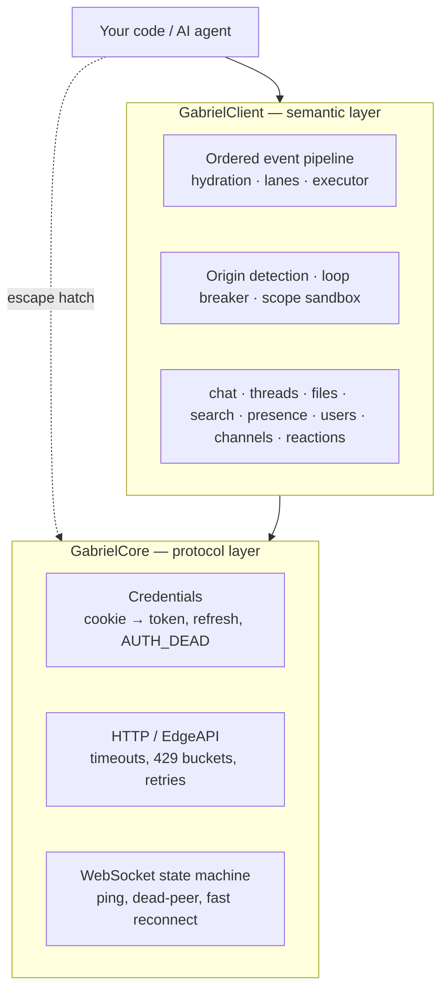
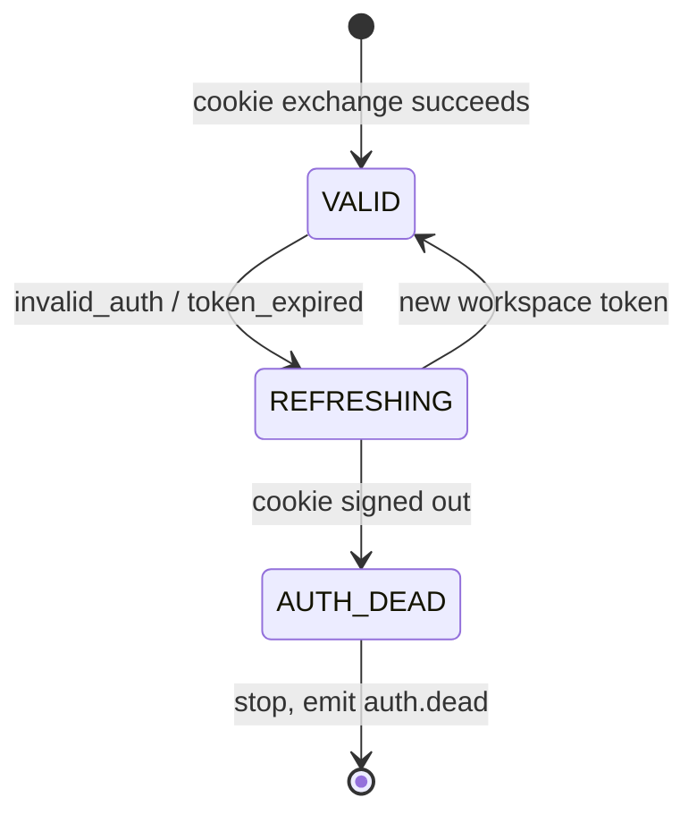
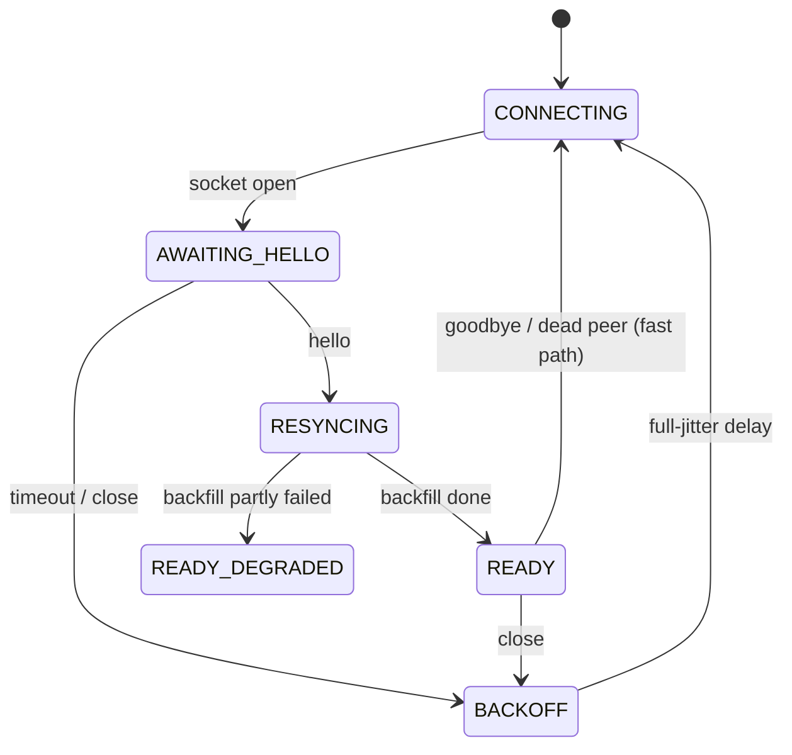

# Architecture

This document explains how Gabriel is built and why. The normative rules (numbers, state
machines, error codes) live in [`spec/behavior.md`](../spec/behavior.md); this page gives the
reasoning behind them. The TypeScript SDK in [`sdks/node`](../sdks/node) is the reference
implementation.

## 1. Goals and non-goals

**Goals**

* Connect with the session a signed-in person already has in the Slack web app, so personal and
  team automation needs no OAuth app and no public webhook.
* Deliver a typed, ordered, de-duplicated event stream that is safe to wire into LLM agents.
* Make the dangerous parts of acting as a person — reply loops, unread markers, prompt
  injection, runaway tools — safe by default.
* Keep one language-neutral contract so Go and Python SDKs behave identically.

**Non-goals**

* Replacing official Slack apps. If you can install an app, use Slack's official SDKs.
* Bot-token features (slash commands, interactive components, app home).
* Hiding the protocol: the low layer stays reachable for anything not modeled yet.

## 2. Two layers



* **Core** is faithful and assumption-free: frames are delivered unmodified, every Web API /
  EdgeAPI method is callable, and the transport is resilient. It never fetches extra data on its
  own.
* **Client** adds meaning: typed events, names instead of IDs, ordering guarantees, loop
  protection, subscriptions, sending, recovery and the AI sandbox. It is built only on Core, and
  exposes Core as `client.core`.

This split keeps the high-level API opinionated without ever blocking users from new protocol
features: an unmodeled frame is still one `core.onEvent()` away.

## 3. Credentials

The only required secret is the `d` session cookie. Everything else is derived:



* Concurrent failures share one refresh (singleflight) and replay once, so a burst of requests
  never causes a burst of exchanges.
* `AUTH_DEAD` is terminal on purpose: retrying a dead cookie only produces noise. The application
  gets `auth.dead` and `health().status === "dead"` and can alert a human.
* Refreshed tokens are never handed to application code, and credentials never appear in events,
  logs or errors. A rejected (outdated) browser identity is reported separately so it is never
  mistaken for a dead session.

## 4. Connection lifecycle



* **Epochs.** Every socket gets a new epoch; callbacks from older sockets are ignored, which
  removes a whole class of reconnect races.
* **Liveness.** A ping every 10 s and a 25 s silence limit detect half-open connections that TCP
  alone would not notice for minutes.
* **Fast reconnect.** The gateway hands out short-lived reconnect tickets. Using one replays frames
  missed while disconnected, but no subscription survives any reconnect — so every `hello`
  replays them.
* **Pending commands** are rejected the moment their socket closes; nothing waits forever.

## 5. The event pipeline

```text
frame ─► normalize ─► (de-dup) ─► hydrate (≤300 ms) ─► lane (per channel) ─► reply router ─► executor ─► handlers
                                                                                 │
                                                       ctx.waitForReply waiters ◄┘
```

1. **Normalize — one primary event per frame.** A new message is always exactly one
   `message.created`, whether it is a channel post, a thread reply or a broadcast. Edits that only
   change metadata produce nothing, and AI streaming updates are separate from human edits. One
   message can therefore never trigger two overlapping handlers.
2. **De-duplicate** by `eventId`, a key derived from raw fields (`channel:ts:created`, or
   `channel:ts:updated:eventTs` for edits, so repeated edits stay distinct). Reconnect replays and
   backfill can overlap safely.
3. **Hydrate with a budget.** User, channel and group names are looked up through batching
   loaders (one request per short window, cached, misses cached too). Lookups start immediately and
   in parallel, but each event waits at most 300 ms; unresolved mentions keep their raw form and
   can be completed later with `ctx.hydrateRemaining()`.
4. **Lanes keep order.** Events are emitted per channel in arrival order even when a later event
   hydrates faster. Lane keys come only from raw fields, never from lookup results.
5. **Reply router.** Messages are offered to `waitForReply` waiters before they reach the
   executor, so a conversation can continue even when the queue is full.
6. **Bounded executor.** Handlers run with global and per-key limits (per channel by default, per
   thread on request). A waiting handler releases its slot and resumes ahead of queued work, which
   prevents re-entrancy deadlocks. Handler errors are isolated; slow handlers are cancelled through
   `ctx.signal` and eventually released.

Overload never blocks the socket reader: excess events are dropped with `guard.overflow` and
re-fetched later by recovery.

## 6. Acting as a person safely

A session acts as the signed-in person, so an automation reading its own replies would loop.

* **Origin.** Every write registers its `client_msg_id` *before* the request is sent, so the
  WebSocket echo — which can beat the HTTP response — is always recognized. Events carry
  `origin`: `this_client`, `self_other_client` (the same person elsewhere), `other_user` or `bot`.
  `this_client` echoes are filtered by default.
* **Loop breaker.** Writes made from inside handlers are counted per (channel, thread); past the
  limit they fail with `LOOP_DETECTED` and `guard.loop_detected` fires.
* **Unread cursor.** Posting marks a channel as read for the person. `preserveUnreadCursor`
  restores the previous position afterwards, unless the person read the channel meanwhile.

## 7. Subscriptions

Presence and profile/DND updates are opt-in per user, through two independent pools:

* The **presence pool** sends the full desired set every time (the gateway overwrites, it does not
  merge) and enforces a serialized-frame size limit, because an oversized frame is silently dropped
  together with every existing subscription.
* The **profile/DND pool** is incremental, acknowledged and capped per connection.

Both are reference-counted (`watch()` returns a handle) and reconciled by a single writer, so
concurrent `watch` / `unwatch` calls and reconnects never race. Snapshots are diffed against a cache
so reconnects do not flood handlers with "user is online" events.

## 8. Sending

* **Ordering and priority.** Posts to one channel are strictly FIFO. A shared semaphore limits
  concurrency and reserves a slot for interactive replies, so direct answers still go out during an
  alert storm.
* **Idempotency.** Every post carries a `client_msg_id`; the server de-duplicates on it, so network
  retries can never produce duplicates.
* **Length.** Messages are measured the way the server counts them (code points, newlines after
  form encoding, emoji expansion) and split on paragraph, line and word boundaries; code fences
  are closed and reopened and table headers repeated.
* **Streaming.** Session tokens cannot use Slack's native streaming APIs, so a stream is a
  placeholder message refreshed with edits: one request in flight per stream, the latest content
  wins, fences are closed on the rendered copy, long output continues in a new message, and
  deleting the message in Slack cancels the stream (and the LLM call behind it).

## 9. Recovery

* A **watermark** per channel advances only when every older new-message event has been handled
  (or dropped and pinned for later). It is persisted with a monotonic max-merge.
* After a cold reconnect or a restart with a persistent store, the client buffers live frames,
  fetches what was missed (channel history from the watermark, and replies of threads it
  participates in — thread replies never appear in channel history), delivers that as
  `delivery: "backfill"` in order, then releases the buffered live frames.
* Every recovery ends with a `connection.gap` report; `recovered: false` lists exactly which ranges
  could not be fetched, so "no message lost" is a checked claim, not an assumption.

## 10. AI safety

* `evt.toLLMContext()` separates metadata from content and wraps content in an
  `untrusted="true"` envelope, neutralizing sequences that could close it.
* `client.scope(policy)` returns the same API restricted to allow-listed channels, optionally
  without search, with a download size cap, an action allow-list, an approval hook for every
  write, and — with `trigger_thread_only` — writes limited to the channel and thread that
  triggered the running handler. The low-level core is not reachable from a scoped view.

The intent: even if a model is prompt-injected, it cannot read beyond its channels or speak
outside its thread.

## 11. Extension points

| Need | Hook |
| :--- | :--- |
| Unmodeled frames or API methods | `client.core.onEvent()`, `callWebApi()`, `callEdgeApi()`, `sendWsCommand()` |
| Persistence | `StateStore` interface (`MemoryStateStore`, `FileStateStore` built in) |
| Observability | `metrics` sink and a pino-style `logger` |
| Proxies, tests | inject `fetch` and a WebSocket factory |
| Cross-cutting handler logic | `client.use(middleware)` |

## 12. Multi-language parity

Every SDK implements [`spec/behavior.md`](../spec/behavior.md), serializes events exactly as
[`spec/schema/events.schema.json`](../spec/schema/events.schema.json) describes, and passes every
case in [`spec/fixtures/normalize`](../spec/fixtures/normalize). APIs follow each language's idioms
(`context.Context` and functional options in Go, `async with` and keyword arguments in Python) while
event payloads stay identical.

## 13. Roadmap

Planned, not yet implemented: a Redis-backed `StateStore` with multi-replica leases, a local daemon
sharing one Slack connection between several agent processes, OpenTelemetry spans, and the Go and
Python SDKs.
